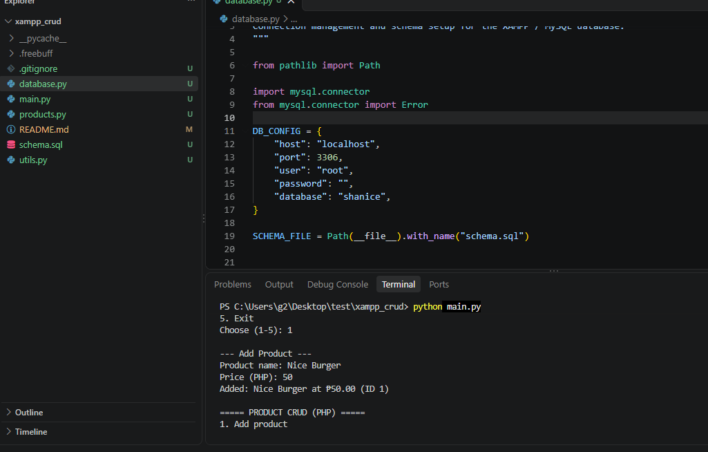
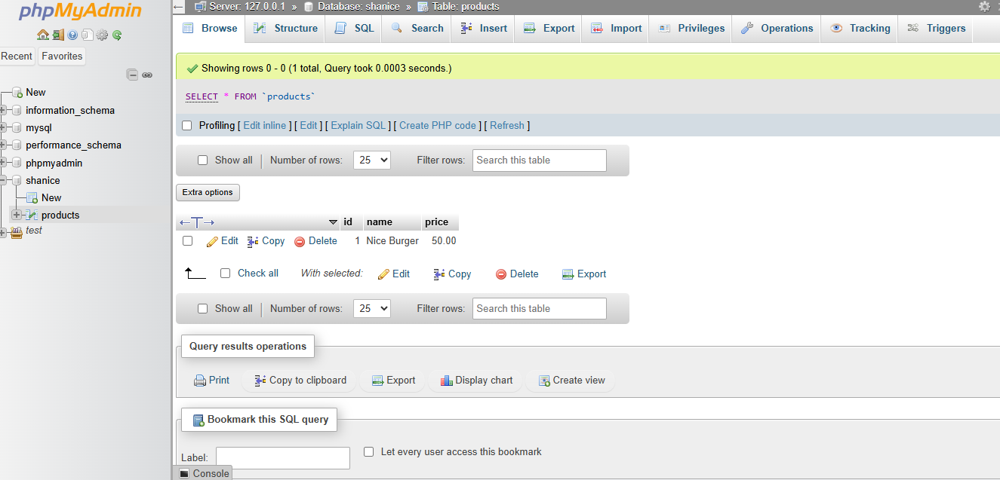

# Product CRUD — Python + XAMPP (MySQL)

A simple command-line CRUD (Create, Read, Update, Delete) system for a **product listing** (name + price) that connects to a XAMPP MySQL database. Prices are shown in **Philippine Peso (₱ PHP)**.

## Requirements

1. **XAMPP** installed and running — start **Apache** and **MySQL** from the XAMPP Control Panel.
2. **Python 3.8+**
3. Install the MySQL connector:

```bash
pip install mysql-connector-python
```

## Setup

1. Start MySQL in the XAMPP Control Panel.
2. No manual setup needed — the first run of `main.py` creates the database and the `products` table automatically. The database name comes from `DB_CONFIG` in `database.py` (currently **`shanice`**).

```sql
CREATE TABLE IF NOT EXISTS products (
    id    INT AUTO_INCREMENT PRIMARY KEY,
    name  VARCHAR(255) NOT NULL,
    price DECIMAL(10, 2) NOT NULL
);
```

This schema lives in **`schema.sql`** and is applied by `setup_database()` in `database.py` on every startup, so nothing is missing — it just isn't created manually in phpMyAdmin.

Default connection settings (change in `database.py` if yours differ):

| Setting  | Value       |
|----------|-------------|
| Host     | `localhost` |
| Port     | `3306`      |
| User     | `root`      |
| Password | *(empty)*   |

## Usage

```bash
python main.py
```

Sample session:

```
===== PRODUCT CRUD (PHP) =====
1. Add product
2. View products
3. Update product
4. Delete product
5. Exit
Choose (1-5): 1

--- Add Product ---
Product name: Lucky Me Pancit Canton
Price (PHP): 16.50
Added: Lucky Me Pancit Canton at ₱16.50 (ID 1)

--- Product List ---
ID     PRODUCT NAME                   PRICE (PHP)
--------------------------------------------------
1      Lucky Me Pancit Canton                 ₱16.50
2      Bear Brand Milk                       ₱225.00
```

## Files

| File                   | Purpose                                                     |
|------------------------|-------------------------------------------------------------|
| `schema.sql`           | Table definitions (the database schema)                      |
| `database.py`          | Connection config, connection factory, and schema loading    |
| `products.py`          | Data-access layer — all SQL for products (CRUD functions)   |
| `utils.py`             | Shared helpers — peso formatting and input validation       |
| `main.py`              | Interactive CLI menu tying it all together                  |
| `README.md`            | This guide                                                  |

## Architecture

The code is split into clear layers so each file has one job:

```
main.py            → menu + user interaction only
 ├── utils.py       → ₱ formatting, input prompts/validation
 └── products.py    → all SQL (SELECT/INSERT/UPDATE/DELETE)
      └── database.py → connection config + applies schema.sql
```

To change a menu item or add a currency format, touch `main.py` / `utils.py` only.
To change the table or add a column, touch `database.py` + `products.py` only.

## Screenshots

### Main menu CLI



### Product list — prices in Philippine Peso (₱) inside Xamp Mysql Admin



> To add your own screenshots, save them as `docs/screenshot-menu.png` and `docs/screenshot-list.png`, or update the paths above.

## Author

**Kenneth Panio**

## Notes

- Prices are stored as `DECIMAL(10, 2)` — up to a million pesos per item.
- You can also view the data in **phpMyAdmin**: <http://localhost/phpmyadmin> → database `shanice` → table `products`.
- If you get a connection error, make sure MySQL is running in the XAMPP Control Panel.
